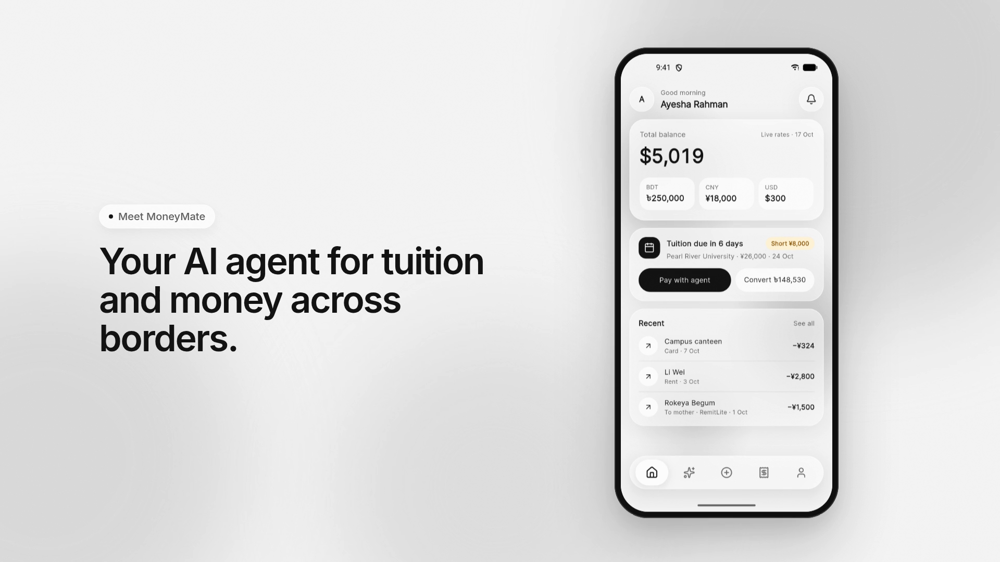
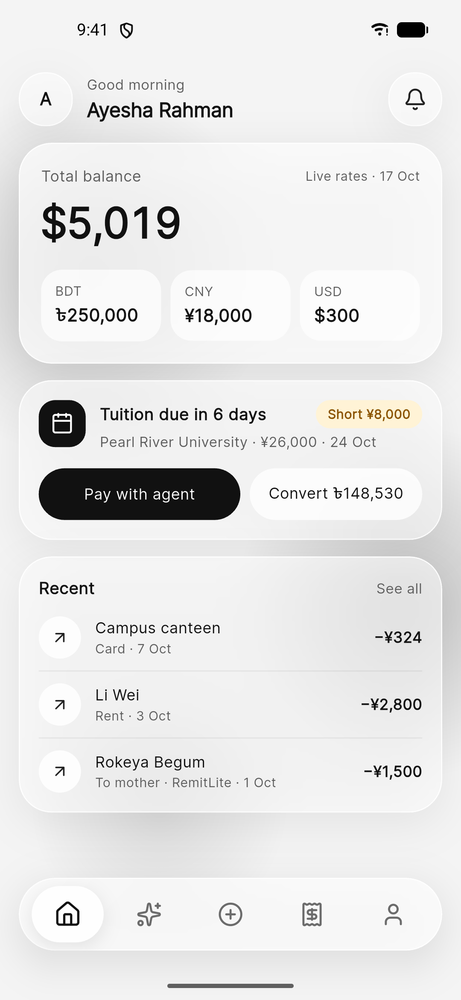
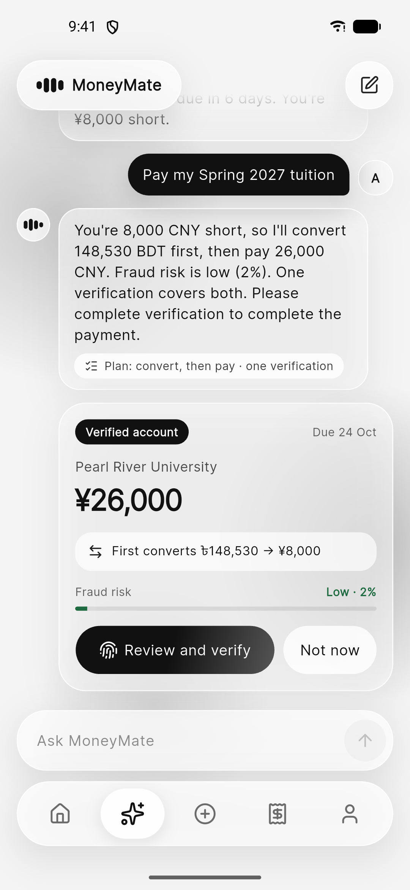
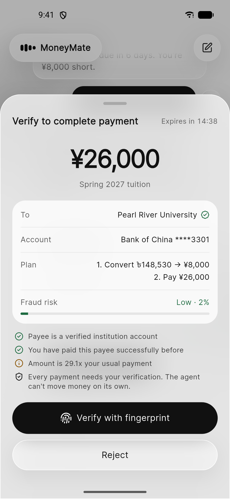
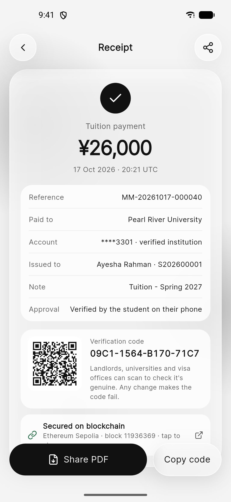
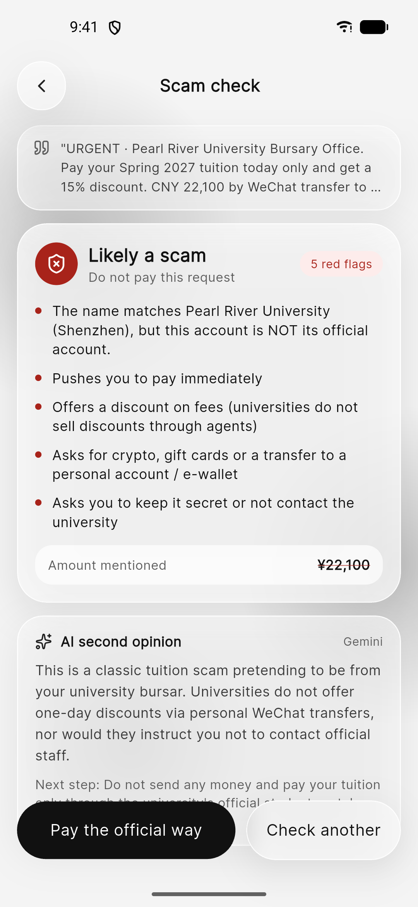
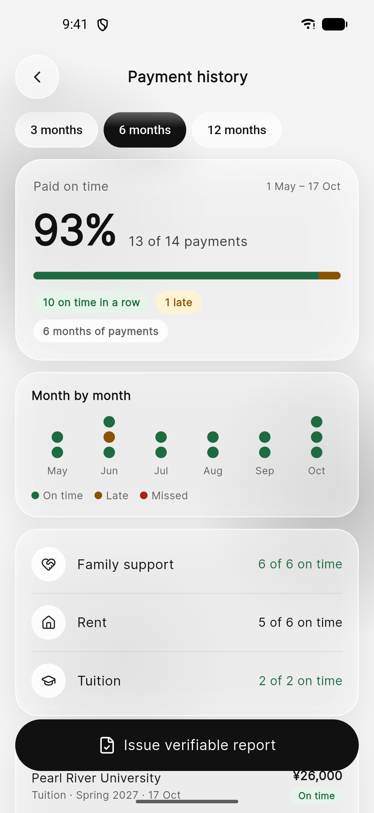
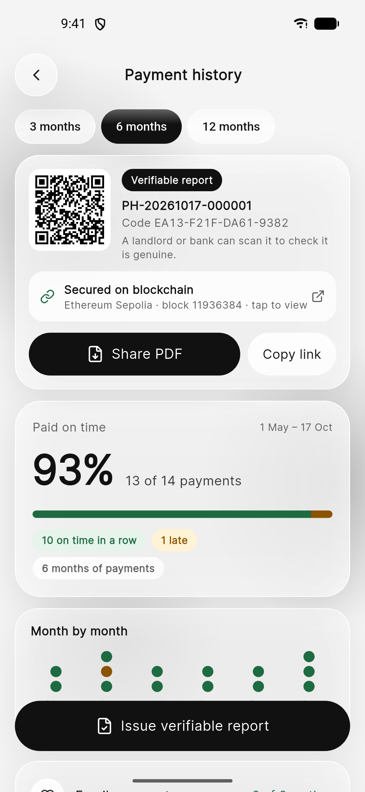
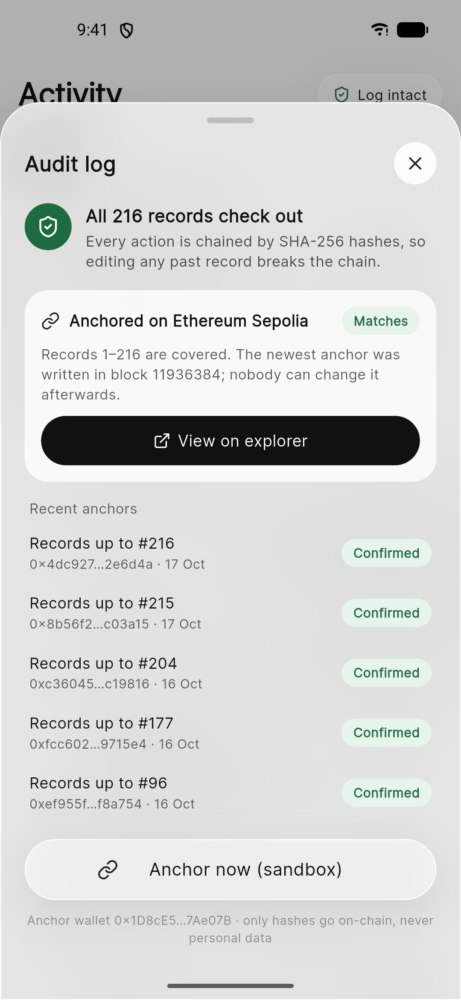
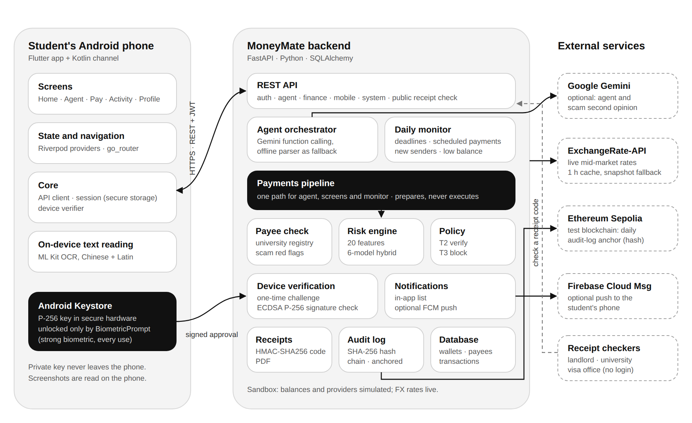

<div align="center">

# MoneyMate Agent

**An AI agent for international students' tuition and cross-border money, which never pays without the student's fingerprint.**

2026 Shenzhen International FinTech Competition (FinTechathon) · International Track<br>
**Topic C: Cross-border & Student Finance Assistant** · Theme: *AI as a Financial Participant*


[](docs/video/moneymate-intro.mp4)

**[▶ Watch the 60-second intro](docs/video/moneymate-intro.mp4)** ·
[Technical documentation](docs/TECHNICAL_DOCUMENTATION.md) ·
[Architecture & security (PDF)](docs/ARCHITECTURE_AND_SECURITY.pdf) ·
[Security self-assessment](docs/SECURITY_SELF_ASSESSMENT.md) ·
[Sandbox operation log (PDF)](docs/evidence/sandbox/SANDBOX_OPERATION_LOG.pdf)

</div>

---

> **The agent prepares every payment. Only the student can complete it.**
> MoneyMate plans tuition payments, remittances and conversions, compares providers, checks payees and scores
> fraud risk, but it has no way to move money on its own. Each payment waits for a signature from the student's
> Android phone, unlocked by their fingerprint. Scam requests are blocked before money moves, and every action is
> written to a hash-chained audit log anchored on a public blockchain.

> **Sandbox.** Accounts, balances and remittance providers are simulated; exchange rates are live mid-market
> rates. No real money moves.

## Contents

- [Submission checklist](#submission-checklist)
- [The problem](#the-problem)
- [What the agent does](#what-the-agent-does)
- [Screens](#screens)
- [Architecture](#architecture)
- [Core algorithms](#core-algorithms)
- [Security design](#security-design)
- [Tech stack](#tech-stack)
- [Quick start (local)](#quick-start-local)
- [Deployment](#deployment)
- [Configuration](#configuration)
- [Tests and execution evidence](#tests-and-execution-evidence)
- [Project layout](#project-layout)
- [Documentation](#documentation)
- [Scope and honesty notes](#scope-and-honesty-notes)

## Submission checklist

Where each competition deliverable lives in this repository:

| # | Deliverable | Where |
|---|---|---|
| 1 | Technical documentation (architecture, core algorithm, security design) | [docs/TECHNICAL_DOCUMENTATION.md](docs/TECHNICAL_DOCUMENTATION.md), [docs/ARCHITECTURE_AND_SECURITY.md](docs/ARCHITECTURE_AND_SECURITY.md) ([PDF](docs/ARCHITECTURE_AND_SECURITY.pdf), [Word](docs/ARCHITECTURE_AND_SECURITY.docx)) |
| 2 | Presentation deck (≤ 10 min) | submitted separately |
| 3 | Demo video (≤ 5 min) | 60-second intro: [docs/video/moneymate-intro.mp4](docs/video/moneymate-intro.mp4); full demo submitted separately |
| 4 | Source code, README, deployment instructions, tests | this repository · [Deployment](#deployment) · [Tests](#tests-and-execution-evidence) |
| 5 | Security self-assessment (permission tiers, known-risk list) | [docs/SECURITY_SELF_ASSESSMENT.md](docs/SECURITY_SELF_ASSESSMENT.md) |
| 6 | Execution evidence (sandbox operation logs) | [docs/evidence/sandbox/](docs/evidence/sandbox/) ([PDF](docs/evidence/sandbox/SANDBOX_OPERATION_LOG.pdf)) |
| + | On-chain challenge bonus | [docs/evidence/ONCHAIN_ANCHOR.md](docs/evidence/ONCHAIN_ANCHOR.md): real Ethereum Sepolia transactions |

## The problem

Millions of students study abroad and pay tuition, rent and family support across borders, in more than one
currency. They lose money in three ways:

1. **Scams aimed at students:** fake "bursary office" invoices with a "15% discount", fake immigration officers,
   part-time "jobs" that turn the student into a money mule.
2. **Cost:** bank wires and poor FX margins; no easy way to see the cheapest route.
3. **No financial footprint:** an on-time rent record from home doesn't count abroad, so landlords and banks ask
   for guarantees.

An AI agent can do the planning, comparing and checking, but an agent that can move money is itself a risk:
prompt injection, a wrong amount, a stolen password. MoneyMate is designed so the agent is a **financial
participant without spending power**.

## What the agent does

| Task (Topic C) | What happens |
|---|---|
| **Tuition payments** | "Pay my tuition" → finds the open invoice, verifies the payee against the official university registry, scores risk. If the wallet is short, it plans the conversion from the home currency too: one plan (convert, then pay), one verification. Fake agents, "discounts" and look-alike accounts are blocked. |
| **Remittances** | "Send 2000 CNY to mother" → compares providers (fee + FX margin), picks the cheapest, scores risk and prepares the transfer. Even a small transfer to family waits for the student's verification. |
| **Multi-currency management** | BDT / CNY / USD wallets and conversion at live mid-market rates (ExchangeRate-API, hourly; snapshot fallback). Conversions are verified like payments. |
| **Scam check** | Paste any invoice, email or message (or a screenshot, read on the phone): rule-based red flags (urgency, discounts, threats, crypto / gift cards, secrecy, impersonated accounts) plus a Gemini second opinion that can raise, never lower, the warning. |
| **Money-mule shield** | Money from a first-time sender that is quickly forwarded to a new payee is blocked before the student becomes a mule; a warning is sent the moment large money arrives from someone new. |
| **Standing instructions** | "Every month send 1000 CNY to father on 3rd" → on the due day the agent prepares the payment and asks the student to verify it (24 h window). Never prepared twice in a month, never paid automatically. |
| **Daily monitor + notifications** | Every morning: tuition deadlines, standing instructions due, large money from first-time senders, low balance. Every prepared payment sends "Please complete verification to complete the payment". |
| **Tuition deadline reminders** | Warnings 14, 7 and 3 days before the due date (and when overdue), with whether the wallet covers the invoice and what converting costs today. |
| **Credit building** | A payment history report: rent, family support and tuition marked on time, late or missed over 3–12 months, shared as a PDF with a QR code a landlord or bank can check without an account. A real payment record, not a credit score. |
| **Payment proof** | Every completed payment gets a receipt (reference, PDF) with an HMAC verification code anyone can check at a public link; any change to the payment invalidates it. |
| **On-chain audit anchor** | The audit log's latest hash is written to the Ethereum Sepolia test network, so nobody can rewrite payment history unnoticed, not even someone with database access. Only hashes go on-chain. |

## Screens

<table>
<tr>
<td align="center"><br><sub>Home</sub></td>
<td align="center"><br><sub>Agent plans the payment</sub></td>
<td align="center"><br><sub>Verify with fingerprint</sub></td>
<td align="center"><br><sub>Verifiable receipt</sub></td>
</tr>
<tr>
<td align="center"><br><sub>Scam check</sub></td>
<td align="center"><br><sub>Payment history</sub></td>
<td align="center"><br><sub>Shareable report</sub></td>
<td align="center"><br><sub>Audit log on Sepolia</sub></td>
</tr>
</table>

## Architecture



```
Client (Android app / API)     Daily monitor (every morning: deadlines, standing instructions,
        │                      new-sender money, low balance)
        ▼                               │ prepares scheduled payments
AI agent (Gemini function calling, or offline intent parser)
        │ proposes a tool call          │
        ▼                               ▼
   Tool layer ──► read tools (T0): balances, quotes, payee check, scam check, reminders, receipts
        │
        ▼ money tools (pay tuition, send money, convert, scheduled payment)
Behavioural features (20) ──► Hybrid risk model ──► Policy engine
                               6 base models          T2 VERIFY: prepared, waits for the student
                               + LR meta-learner      T3 BLOCK: refused with reasons
        ▼
Prepared payment + "Please complete verification" notification + audit entry
        ▼
Student verifies on their Android phone (fingerprint unlocks a Keystore key that signs a one-time challenge)
        ▼
Money moves in the sandbox ledger ──► receipt + audit entry ──► audit head anchored on Ethereum Sepolia
```

The agent, the app's own screens and the daily monitor all go through **one payment pipeline**, so the same
checks apply whoever starts a payment. The LLM never decides whether money moves: the policy engine decides whether
a payment may be prepared or must be blocked, and only a signature from the student's registered phone completes
it. More: [docs/ARCHITECTURE_AND_SECURITY.md](docs/ARCHITECTURE_AND_SECURITY.md) and
[payment lifecycle](docs/diagrams/payment-lifecycle.png).

## Core algorithms

**Hybrid fraud model** (`backend/app/services/risk/`, `backend/ml/`)
- 20 behavioural features per payment: amount against the student's history, payee age and type, channel,
  country, time of day, money that just arrived from a stranger, and more.
- Base learners: Logistic Regression, Random Forest, XGBoost, HistGradientBoosting, a feed-forward neural
  network, and an autoencoder trained on legitimate payments (anomaly score). Out-of-fold predictions train a
  logistic-regression meta-learner (stacking).
- Risk levels: LOW < 0.10 ≤ MEDIUM < 0.70 ≤ HIGH. HIGH is blocked.
- Explanations: TreeSHAP contributions from the XGBoost learner, turned into plain-language reasons.
- Held-out test (synthetic data): ROC-AUC 0.937, PR-AUC 0.879; at the block threshold precision 98.0%,
  recall 79.8% (`backend/ml/artifacts/metrics.json`). No public dataset covers student tuition / remittance
  fraud, so the model is trained on synthetic data generated from documented fraud typologies
  (`backend/ml/generate_data.py`); partner data from banks and universities would replace it.

**Agent** (`backend/app/services/agent/`): Gemini function calling over a fixed set of tools, with a model
fallback chain and a 15-second timeout; if Gemini is unavailable, a deterministic intent parser calls the same
tools, so the product always works. Pasted messages are treated as data, never as instructions.

**Scam check** (`backend/app/services/verification.py`): red-flag rules and a payee check against the verified
institution registry (name matches, account doesn't → impersonation). The Gemini second opinion can only raise the
warning.

**Payment planning** (`backend/app/services/payments.py`): exact shortfall conversion before a tuition payment, and
provider ranking by what the recipient actually receives (fee + FX margin).

**Payment history** (`backend/app/services/history.py`): monthly payments count as on time if paid by the due day
plus 3 days of grace; tuition by its due date; otherwise late, or missed if never paid. Reports are snapshots with a
domain-separated HMAC code; the public check reveals only the summary.

**Audit log and anchoring** (`backend/app/services/audit.py`, `anchor.py`): every action is a SHA-256 hash-chain
entry. Each anchor is a zero-value Ethereum Sepolia transaction from the anchor wallet to itself whose 44-byte data
field is `"MMA1"` + entry id + entry hash. Verification fetches the transaction from the chain and compares it with
the database; a consistently rewritten log no longer matches.

## Security design

| Tier | When | Agent behaviour |
|---|---|---|
| T0 Read | balances, quotes, checks, reminders, receipts, setting up a standing instruction | runs immediately; no money moves |
| T2 Verify | **every** movement of money that is not blocked: payments, transfers, conversions, scheduled payments | prepared, then waits for the student's phone (15 min; 24 h for scheduled payments) |
| T3 Block | HIGH risk, impersonated institution account, mule pattern, crypto / gift card to a person, tuition to an unverified account | refused with reasons |

There is deliberately **no auto-execute tier**: the agent never moves money without the student, however small
the amount or familiar the payee.

**Device-bound verification.** The app creates a P-256 key in the Android Keystore (StrongBox when available),
usable only after a fingerprint / face unlock (`BIOMETRIC_STRONG`) and invalidated when a new biometric is enrolled.
Only the public key is registered. Each prepared payment gets a one-time nonce; the phone signs
`moneymate-verify:{action_id}:{nonce}` with `SHA256withECDSA`; the server checks the signature, the owner and the
expiry, then clears the nonce so it can't be replayed. A stolen password or a message to the agent cannot produce
this signature.

Also: JWT sessions (2 h) with bcrypt passwords and per-student data scoping, HMAC receipts, a hash-chained audit
log anchored on-chain, account numbers shown as the last 4 digits, screenshots read on the phone and never
uploaded. Full threat model, controls and the known-risk list:
[docs/SECURITY_SELF_ASSESSMENT.md](docs/SECURITY_SELF_ASSESSMENT.md).

## Tech stack

| Layer | Technology |
|---|---|
| Android app | Flutter (Dart), Riverpod, go_router; Kotlin platform channel for Android Keystore + BiometricPrompt; Firebase Cloud Messaging (optional) |
| Backend | Python 3.12, FastAPI, SQLAlchemy 2 (SQLite by default; MySQL / Postgres via `DATABASE_URL`), JWT + bcrypt |
| AI | Google Gemini (function calling, scam second opinion) with an offline intent-parser fallback |
| Fraud model | scikit-learn, XGBoost, NumPy / pandas; TreeSHAP explanations |
| Blockchain | Ethereum Sepolia via JSON-RPC; transactions signed with `eth-account` |
| Documents | ReportLab (receipt and report PDFs with QR codes) |
| FX | ExchangeRate-API open access (live mid-market rates, snapshot fallback) |

## Quick start (local)

Requirements: Python 3.11+ for the backend (or Docker); Flutter (Dart 3.13+) and the Android SDK for the app.

**1. Backend** on <http://localhost:8000> (interactive API docs at <http://localhost:8000/docs>)

```bash
cd backend
python -m venv .venv && source .venv/bin/activate      # Windows: .venv\Scripts\activate
pip install -r requirements.txt
cp .env.example .env        # set JWT_SECRET_KEY; GEMINI_API_KEY is optional
uvicorn app.main:app --host 0.0.0.0 --port 8000
```

The database is created and seeded with the demo student on first start.

**2. Android app** (emulator or phone, API 23+)

```bash
cd app
flutter pub get
flutter run                                             # emulator: reaches the backend at 10.0.2.2:8000
flutter run --dart-define=API_BASE=http://<laptop-ip>:8000/api --dart-define=PUBLIC_BASE=http://<laptop-ip>:8000   # phone on the same Wi-Fi
```

Sign in as the demo student **`ayesha`** (password: `DEMO_USER_PASSWORD` in `backend/.env`, default
`Demo@2026`, sandbox only), or create an account. To verify payments the phone needs a screen lock and an enrolled
fingerprint. Details: [app/README.md](app/README.md), [docs/ANDROID_INTEGRATION.md](docs/ANDROID_INTEGRATION.md),
five-minute demo: [app/docs/DEMO_SCRIPT.md](app/docs/DEMO_SCRIPT.md).

**3. Try it without the app.** In the API docs, call `POST /api/auth/login`, click **Authorize** with the token,
then `POST /api/agent/chat` with `{"message": "Pay my tuition"}`. The answer is `AWAITING_VERIFICATION` with a
two-step plan (convert BDT, then pay) and a verification notification (`GET /api/notifications`). To complete it
without a phone:

- set `VERIFICATION_MODE=sandbox` in `backend/.env`, restart, and send
  `POST /api/agent/actions/{id}/verify` with `{"sandbox": true}` (demos only; refused when
  `ENVIRONMENT=production`); or
- play the phone with a real P-256 key: register it with `POST /api/devices`, fetch
  `GET /api/agent/actions/{id}/challenge`, sign it and send `POST /api/agent/actions/{id}/verify`.
  [backend/scripts/sandbox_evidence.py](backend/scripts/sandbox_evidence.py) (`KeystorePhone`) shows the exact calls.

To see the daily monitor without waiting for the morning: `POST /api/monitor/run`, optionally with
`?day=YYYY-MM-DD` to simulate a date (e.g. the 1st of next month prepares the monthly transfer to mother).

**Gemini (optional):** get a free key at <https://aistudio.google.com/apikey> and set `GEMINI_API_KEY`. Without
it, the offline intent parser answers and calls the same tools.

**Retrain the model (optional, about 8 min on CPU):**

```bash
cd backend
python -m ml.generate_data --rows 80000
python -m ml.train_hybrid
```

## Deployment

The backend ships as a Docker image ([backend/Dockerfile](backend/Dockerfile)). A small server with 1–2 vCPU and
2 GB RAM is enough. For judges in Shenzhen, a region such as Singapore keeps it fast, and Gemini is available
there.

**1. Build and run the backend**

```bash
git clone https://github.com/Kiyas-Mahmud/MoneyMate-Agent.git
cd MoneyMate-Agent/backend
cp .env.example .env        # fill in the values below
docker build -t moneymate-backend .
docker run -d --name moneymate --restart unless-stopped \
  -p 127.0.0.1:8000:8000 --env-file .env -v moneymate-data:/data moneymate-backend
curl http://127.0.0.1:8000/api/anchors     # health check
```

The SQLite database lives in the `moneymate-data` volume (`/data/moneymate.db`), so the audit log, payments and
anchors survive restarts and upgrades. To use MySQL or Postgres instead, set `DATABASE_URL`.

For a production server, set at least:

```
ENVIRONMENT=production
JWT_SECRET_KEY=<python -c "import secrets; print(secrets.token_urlsafe(48))">
RECEIPT_SIGNING_KEY=<another long random value; keep it stable>
PUBLIC_BASE_URL=https://api.your-domain.com
CORS_ORIGINS=https://api.your-domain.com
VERIFICATION_MODE=device
```

`ENVIRONMENT=production` refuses to start with `VERIFICATION_MODE=sandbox` and disables simulated dates and manual
anchoring. For a judging sandbox where the demo tools (reset, simulated dates) should stay available, keep
`ENVIRONMENT=development` but still set fresh secrets.

**2. HTTPS.** Release builds of the Android app only talk to `https://` servers. Put a reverse proxy with automatic
TLS in front of the container, for example [Caddy](https://caddyserver.com) with this `Caddyfile`:

```
api.your-domain.com {
    reverse_proxy 127.0.0.1:8000
}
```

Point the domain's DNS `A` record at the server, then run `caddy run` (or install it as a service); it fetches and
renews the certificate.

**3. Build the release APK for that server**

```bash
cd app
flutter build apk --release \
  --dart-define=API_BASE=https://api.your-domain.com/api \
  --dart-define=PUBLIC_BASE=https://api.your-domain.com
# -> app/build/app/outputs/flutter-apk/app-release.apk
```

**4. Optional services**
- **Blockchain anchoring:** create a fresh wallet that holds no real funds, fund it from a Sepolia faucet, set
  `ANCHOR_ENABLED=true` and `ANCHOR_PRIVATE_KEY`. The daily monitor anchors automatically. Only test networks are
  accepted.
- **Push notifications:** `PUSH_ENABLED=true`, `FCM_PROJECT_ID`, and a Firebase service-account file
  (`FCM_SERVICE_ACCOUNT_FILE`, mounted into the container; never committed).

Upgrading: `git pull`, rebuild the image, then `docker rm -f moneymate` and run it again with the same volume.

## Configuration

All settings come from environment variables or `backend/.env` (template: [backend/.env.example](backend/.env.example)).
Secrets stay in `.env`, which is git-ignored.

| Variable | Default | Purpose |
|---|---|---|
| `JWT_SECRET_KEY` | (required) | Signs login tokens; also the default source of the receipt key |
| `ENVIRONMENT` | `development` | `production` enforces device verification and disables sandbox tools |
| `DATABASE_URL` | SQLite in `backend/` (`/data` in Docker) | SQLAlchemy URL for MySQL / Postgres |
| `VERIFICATION_MODE` | `device` | `device` = phone signature; `sandbox` = API-docs shortcut for demos |
| `CONFIRMATION_TTL_MINUTES` / `SCHEDULED_TTL_HOURS` | `15` / `24` | How long a payment can be verified |
| `GEMINI_API_KEY` | empty | Enables Gemini; empty = offline intent parser |
| `GEMINI_MODEL` / `GEMINI_FALLBACK_MODELS` / `GEMINI_TIMEOUT_SECONDS` | see template | Model chain and per-call timeout |
| `MONITOR_ENABLED` / `MONITOR_HOUR` | `true` / `8` | Daily monitor schedule |
| `FX_LIVE` | `true` | Live mid-market rates; `false` = offline snapshot |
| `RECEIPT_SIGNING_KEY` | derived | HMAC key for receipts and reports; keep it stable |
| `PUBLIC_BASE_URL` | `http://localhost:8000` | Base of the public verify links in QR codes |
| `CORS_ORIGINS` | `http://localhost:3000` | Allowed browser origins |
| `DEMO_USER_PASSWORD` | `Demo@2026` | Password of the seeded demo student |
| `ANCHOR_ENABLED` / `ANCHOR_PRIVATE_KEY` / `ANCHOR_CHAIN_ID` / `ANCHOR_RPC_URLS` / `ANCHOR_EXPLORER_URL` | off / Sepolia | Audit-log anchoring on a test network |
| `PUSH_ENABLED` / `FCM_PROJECT_ID` / `FCM_SERVICE_ACCOUNT_FILE` | off | Firebase push notifications |

## Tests and execution evidence

```bash
cd backend && python -m pytest -q        # 86 tests
cd app && flutter test                   # 15 tests
```

All pass. The backend tests play the phone with real key pairs (an Android-Keystore-style P-256 key and an
Ed25519 test key) and run against a fresh database with no network:

| Suite | Tests | Covers |
|---|---|---|
| `test_scenarios.py` | 26 | Tuition with a planned conversion, fake-invoice block, small family transfer waits for verification, crypto-to-stranger and money-mule blocks, prompt injection in a pasted invoice, another user can't verify, audit tamper detection, agent parsing regressions |
| `test_verification.py` | 13 | No signature → 403, wrong signature, another student's phone, replay, expiry, reject, scheduled payments wait, mule alerts, notifications |
| `test_features.py` | 18 | Reminders, receipt verification and tampering, live FX with fallback, Gemini second opinion (escalates, never downgrades), model fallback chain, stalled Gemini call falls back |
| `test_anchor.py` | 9 | Anchor transaction content, a consistently rewritten log is caught, mainnet and wrong-chain refused, empty wallet sends nothing, chain outage never breaks payments |
| `test_history.py` | 8 | On time / late / missed rules, public verification hides details, snapshot validity, PDF access control |
| `test_android.py` | 7 | P-256 Keystore key verifies, wrong curve refused, new-phone alert, push token rotation, FCM format, push failure is harmless |

**Sandbox operation log.** With the backend running:

```bash
cd backend && .venv/bin/python -m scripts.sandbox_evidence
```

The script resets the sandbox and runs 11 scenarios through the same API the app uses, with the fingerprint
step signed by a simulated Keystore key. It writes the report and raw logs to
[docs/evidence/sandbox/](docs/evidence/sandbox/). Latest run: **34 of 34 checks passed**, audit entries #155–#177,
anchored in Sepolia block 11929233 ([PDF report](docs/evidence/sandbox/SANDBOX_OPERATION_LOG.pdf)).

**On-chain evidence.** The first anchor:
[`0xef955ff4…f8a754`](https://sepolia.etherscan.io/tx/0xef955ff4bbebe03e56a681724df109f62fb3c4aa90d986535ea1bc4ff3f8a754)
(block 11929065), decoded in [docs/evidence/ONCHAIN_ANCHOR.md](docs/evidence/ONCHAIN_ANCHOR.md). Anchor wallet:
[`0x1D8c…E07B`](https://sepolia.etherscan.io/address/0x1D8cE5532A292f5E7B71F96f4031c23a887Ae07B).

## Project layout

```
backend/
  app/
    core/            config, database, auth (JWT + bcrypt)
    models/          users, wallets, payees, invoices, transactions, standing instructions,
                     agent actions, devices, notifications, payment reports, audit log, anchors
    routes/          REST API: auth, finance, agent, history, mobile (devices, notifications,
                     standing instructions, monitor), system (audit, anchors, model card, sandbox)
    services/
      agent/         Gemini orchestrator + fallback chain, tools, offline intent parser, scam second opinion
      risk/          feature builder, hybrid scorer, live engine with explanations
      policy.py      permission tiers (T0 read, T2 verify, T3 block)
      payments.py    tuition / remittance / FX pipeline, verify and reject
      devices.py     phone key registration (P-256; Ed25519 for test clients), signature check
      history.py     payment history and verifiable reports
      audit.py       hash-chained audit log
      anchor.py      audit-log anchoring on Ethereum Sepolia
      receipts.py    receipts, HMAC verification codes, PDF
      verification.py payee registry check and scam red flags
      reminders.py, standing.py, monitor.py, notify.py, sandbox.py
  ml/                synthetic data generator, training pipeline, trained model
  scripts/           sandbox_evidence.py (execution evidence)
  tests/             86 tests
  Dockerfile         production image
app/                 Android app (Flutter + Kotlin Keystore channel), tests, demo script
docs/
  TECHNICAL_DOCUMENTATION.md, ARCHITECTURE_AND_SECURITY.(md|pdf|docx), SECURITY_SELF_ASSESSMENT.md,
  FEATURES.md, ANDROID_INTEGRATION.md
  diagrams/          architecture, payment lifecycle, verification sequence, security layers
  evidence/          on-chain anchor evidence, sandbox operation log
  video/             60-second intro video and its source
```

## Documentation

| Document | What's inside |
|---|---|
| [Technical documentation](docs/TECHNICAL_DOCUMENTATION.md) | Problem, architecture, data model, features, hybrid model, agent design, API, testing, limitations, roadmap |
| [Architecture & security design](docs/ARCHITECTURE_AND_SECURITY.md) ([PDF](docs/ARCHITECTURE_AND_SECURITY.pdf)) | System overview, payment lifecycle, threat model, defence in depth, diagrams |
| [Security self-assessment](docs/SECURITY_SELF_ASSESSMENT.md) | Permission tiers as implemented, verification, prompt-injection defence, known-risk list |
| [Features](docs/FEATURES.md) | Every feature with the real-world problem behind it |
| [Android integration](docs/ANDROID_INTEGRATION.md) | Keystore key, biometric flow, push, every API call the app makes |
| [Sandbox operation log](docs/evidence/sandbox/SANDBOX_OPERATION_LOG.pdf) | Execution evidence: 11 scenarios, every request, decision and audit entry |
| [On-chain anchor](docs/evidence/ONCHAIN_ANCHOR.md) | The first Sepolia anchor, decoded and verified |

## Scope and honesty notes

- Payments are simulated. In production MoneyMate would work through licensed partners (banks, payment
  institutions) and never hold funds.
- Exchange rates are live mid-market rates (ExchangeRate-API, attribution required); provider fees and margins are
  fictional.
- The fraud model is trained on synthetic data (see [Core algorithms](#core-algorithms)).
- The Gemini features send the message text to Google's Gemini API; leave `GEMINI_API_KEY` empty to keep everything
  local.
- The server cannot yet prove the phone key sits in the Keystore behind a biometric (no key attestation), adding a
  phone needs only the login token (the student is notified), and there is no flow to remove or recover a lost phone.
- Blockchain anchoring uses a public **test** network; mainnet is refused by design.
- A scheduled payment the wallet can't cover is not prepared; the student is notified instead.

---

<div align="center">

Built by **Kiyas Mahmud** for the 2026 Shenzhen FinTechathon.

</div>
