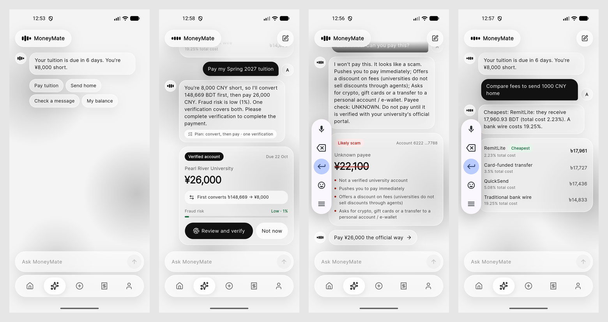

# MoneyMate (Android app)

MoneyMate is an AI finance agent for international students: it pays tuition to verified university accounts,
sends money home by the cheapest route, converts between wallets at live rates and checks scam messages before
anyone pays. **The agent prepares payments but can never send one: every payment waits for the student's
fingerprint.**

This is the Flutter app (Android only). The backend is in [`../backend`](../backend) of this repository.



## Run it

1. Start the backend (see the [main README](../README.md)):
   ```bash
   cd ../backend && .venv/bin/uvicorn app.main:app --host 0.0.0.0 --port 8000
   ```
2. Start an Android emulator (API 23+), then:
   ```bash
   flutter pub get
   flutter run
   ```
   The emulator reaches the backend at `10.0.2.2:8000`. For a real phone on the same Wi-Fi:
   ```bash
   flutter run --dart-define=API_BASE=http://<laptop-ip>:8000/api --dart-define=PUBLIC_BASE=http://<laptop-ip>:8000
   ```
3. Sign in with the demo student `ayesha` (password: `DEMO_USER_PASSWORD` in the backend config), or create an
   account.

To verify payments, the phone needs a screen lock and an enrolled fingerprint (on the emulator: Settings → Security,
then Extended controls → Fingerprint → Touch sensor).

## Tests

```bash
flutter analyze
flutter test
```

## Screens

| Area | What it does |
|---|---|
| Onboarding, Sign in, Register | Three-slide intro, sign-in, account creation with home and study country |
| Home | Total balance at live rates, tuition deadline with shortfall, payments waiting for you, recent activity |
| AI agent | Chat that prepares payments, explains its plan (convert, then pay), runs scam checks, compares routes |
| Verify sheet | Amount, payee, plan, fraud risk and countdown; approve with fingerprint (Android Keystore) or reject |
| Receipt | Signed receipt with QR verification code; share as PDF |
| Tuition | Invoice, wallet coverage, reminder timeline, "check before paying", account registry lookup |
| Send money, Add recipient, Sent | Live quotes from four routes, cheapest first; new recipients; confirmation after verifying |
| Scam check | Paste, screenshot or photo (on-device text recognition, Chinese and Latin); verdict, red flags, AI second opinion |
| Activity | Every transaction by day with filters; blocked payments explained; hash-chained audit log check |
| Safety | Money-mule warning when a stranger's money arrives, and "We stopped this transfer" when it is forwarded |
| Notifications, Standing instructions, Profile, Wallet | Alerts that open the right screen; monthly payments (verified each time); security settings and demo tools; conversions |

## How payment verification works

1. The agent (or a screen) prepares a payment; the backend parks it as `AWAITING_VERIFICATION` and notifies the phone.
2. The verify sheet fetches a one-time challenge for that payment.
3. `MainActivity.kt` signs it with a P-256 key held in the Android Keystore that only a strong biometric can unlock,
   once per signature. The private key never leaves the secure hardware.
4. The backend checks the signature against the phone's registered public key and only then moves the money.

See `android/app/src/main/kotlin/com/moneymate/moneymate/MainActivity.kt` and `lib/core/device.dart`.

## Project layout

```
lib/
  app/        router, tab shell, page transitions
  core/       API client, session, phone verification, formatting, theme
  features/   one folder per screen
  widgets/    liquid-glass surfaces, buttons, fields, sheets
docs/
  DEMO_SCRIPT.md   five-minute demo, scene by scene
  screens/         screenshots from the emulator
test/              formatting and agent-card tests
```

## Known limits

- Push notifications (FCM) need the team's Firebase project; the in-app list works without it.
- The AI second opinion needs a Gemini key on the backend; without it, the built-in checks decide (the AI can only
  ever raise a warning).
- Fingerprint approval is implemented and reaches the system prompt; a full approval has not yet been recorded on a
  real phone.
