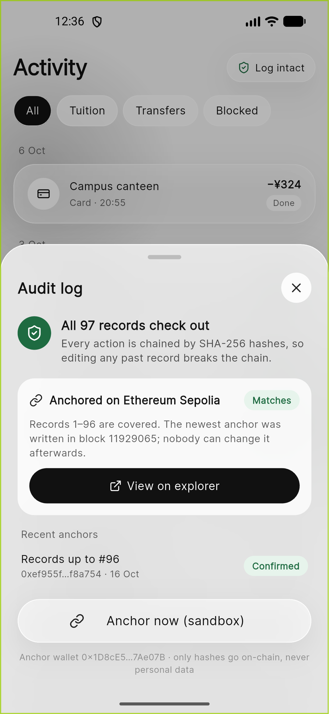

# On-chain audit anchor: execution evidence

The first real anchor of the MoneyMate audit log, written to the Ethereum Sepolia test network on 17 Oct 2026
(16 Oct 18:33 UTC). Anyone can check it on the public explorer; no MoneyMate account is needed.

| | |
|---|---|
| Network | Ethereum Sepolia (chain ID 11155111) |
| Transaction | [`0xef955ff4bbebe03e56a681724df109f62fb3c4aa90d986535ea1bc4ff3f8a754`](https://sepolia.etherscan.io/tx/0xef955ff4bbebe03e56a681724df109f62fb3c4aa90d986535ea1bc4ff3f8a754) |
| Block | 11929065, status success |
| Anchor wallet | [`0x1D8cE5532A292f5E7B71F96f4031c23a887Ae07B`](https://sepolia.etherscan.io/address/0x1D8cE5532A292f5E7B71F96f4031c23a887Ae07B) (sender and receiver, value 0) |
| Gas used | 14,816 (fee about 0.000000003 test ETH) |
| Covers | Audit entries 1–96 |

## What the transaction holds

The data field is 44 bytes, decoded from the chain:

```
0x 4d4d4131                                                          "MMA1" (MoneyMate anchor, version 1)
   0000000000000060                                                  entry id 96
   3e7a6a157f30151c6230df5970bcbfd284f39b24b6dc8b623b0887db61a0bed5  SHA-256 hash of audit entry 96
```

Only the hash goes on-chain, never personal data. Because each audit entry's hash includes the previous one,
this single hash fixes every entry from 1 to 96.

## Verification against the log

`GET /api/audit/verify` after the anchor was mined:

```json
{
  "valid": true,
  "entries": 96,
  "head": "3e7a6a157f30151c6230df5970bcbfd284f39b24b6dc8b623b0887db61a0bed5",
  "anchoring": {
    "chain": "Ethereum Sepolia",
    "anchors": 1,
    "anchored_up_to": 96,
    "checked_on_chain": 1,
    "mismatches": [],
    "on_chain": "ok"
  }
}
```

The backend fetched the transaction from Sepolia, checked the sender is the anchor wallet, and compared the
entry id and hash with the database. They match.

The payment history report `PH-20261016-000001`, issued before entry 96, now reports
`anchor.state = "anchored"`, block 11929065.

## In the app

Activity → **Log intact** → Audit log sheet:



## How to reproduce

1. Set `ANCHOR_ENABLED=true` and an `ANCHOR_PRIVATE_KEY` for a wallet funded with Sepolia test ETH in
   `backend/.env` (see `.env.example`).
2. Sign in and call `POST /api/anchors/run` (or tap **Anchor now (sandbox)** in the Audit log sheet).
3. About 15 seconds later, call it again to record the confirmation, then `GET /api/audit/verify`.

The daily monitor also anchors automatically after its checks. The automated tests in
`backend/tests/test_anchor.py` cover the same flow against a fake chain, including a consistently rewritten
log being caught.
